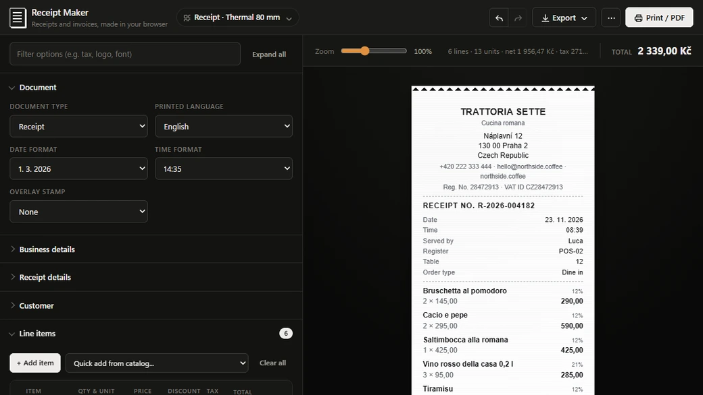

I’m Oliver, a developer based in Prague. I work on **Waygo**, a marketplace for local experiences, and built **Receipt Maker**, a browser tool for receipts and invoices.

[Products](#user-content-selected-work) · [Build notes](#user-content-behind-the-build) · [Client work](#user-content-client-work) · [Code & data](#user-content-code-and-data) · [Contact](#user-content-contact)

## 

| **Waygo** · Marketplace | **Receipt Maker** · Browser tool |
| :--- | :--- |
|  |  |
| **What can we do in Prague today?** A hotel guest scans a QR code, browses local experiences and requests a booking from their phone. | **Can the printed total match every line?** Create a receipt or invoice with per-line VAT and print it on thermal paper or A4. Calculations run in the browser. |
| [Explore Waygo ↗](https://www.waygo.cz/) | [Open Receipt Maker ↗](https://www.zaigla.com/receipt-maker) |

## 

### Waygo · The handoff starts at reception

A guest asks what to do in Prague. The front desk shows them a QR code that opens the catalogue on their phone. The guest requests a booking and receives a voucher after confirmation.

[See the front-desk flow ↗](https://www.waygo.cz/partner/reception) · [Browse experiences ↗](https://www.waygo.cz/discover)

### Receipt Maker · Round the lines before adding them up

The engine rounds each line to the currency’s precision before it groups totals by VAT rate. That keeps what prints on the individual lines consistent with the tax summary. The browser test suite covers calculations, exports, barcodes and QR encoding. You can run all **196 checks** yourself.

[Use the tool ↗](https://www.zaigla.com/receipt-maker) · [Run the test suite ↗](https://www.zaigla.com/receipt-maker/tests)

## 

### RT Likvidace · Turn a service search into a quote request

I built the public website for a Prague clearance company. It gives visitors a place to check what the team handles, see how pricing works and request a quote.

[See the site ↗](https://rychlevyklizenipraha.cz/) · [See pricing ↗](https://rychlevyklizenipraha.cz/cenik)

## 

### zaigla.com · An agent response you can check

Try the order-approval scenario in this interactive demo. It uses sample orders. Four pass the CRM check and two stay in review because the billing addresses don’t match. The response cites the ERP approval queue.

[Try the agent demo ↗](https://www.zaigla.com/en#demo)

### dbt + ClickHouse · A lookup table with schema checks

A public starter that exposes NYC taxi zones as a staging view and defines checks for missing or duplicate location IDs.

| Read the code | What it does |
| :--- | :--- |
| [Source definitions](https://github.com/LiveFuller/ideal-tribble/blob/main/models/staging/sources.yml) | Declares the raw taxi tables and zone lookup. |
| [Staging SQL](https://github.com/LiveFuller/ideal-tribble/blob/main/models/staging/stg_taxi_zones.sql) | Turns fields such as `LocationID` and `Zone` into `location_id` and `zone_name`. |
| [Schema checks](https://github.com/LiveFuller/ideal-tribble/blob/main/models/staging/schema.yml) | Defines the uniqueness and non-null checks on the zone ID. |

[Browse the starter ↗](https://github.com/LiveFuller/ideal-tribble)

## Contact

Working on a booking flow, internal tool or data pipeline? Tell me where it starts and who needs the result.

[Email](mailto:oliver@zaigla.com) · [Portfolio ↗](https://www.zaigla.com/en) · [LinkedIn ↗](https://www.linkedin.com/in/zaigla/)
