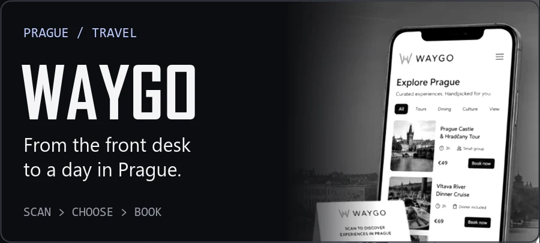
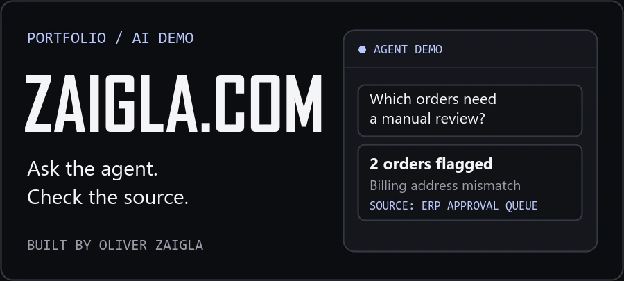

I’m Oliver, a developer in Prague. I’m building **Waygo**, where a card on a hotel desk is the start of a booking, and **zaigla.com**, where you can try my demos for AI and automation.

[**Featured builds**](#featured-builds) · [**Try the agent demo**](#try-the-agent-demo) · [**More work**](#more-work) · [**Contact**](#contact)

## Featured builds

| [**Waygo ↗**](https://www.waygo.cz/) | [**zaigla.com ↗**](https://www.zaigla.com/en) |
| :--- | :--- |
|  |  |
| **From a hotel QR code to a booking request.** A guest scans the card, browses Prague experiences and makes a request on their phone. Waygo sends the voucher after confirmation. | **An interactive portfolio of my work.** Browse projects in web development and automation, see code examples, or run a simulated assistant over sample operations data. |
| [Browse the catalogue ↗](https://www.waygo.cz/) · [See the front-desk flow ↗](https://www.waygo.cz/partner/reception) | [Explore the portfolio ↗](https://www.zaigla.com/en/projects) · [Open the agent demo ↗](https://www.zaigla.com/en#demo) |

## Try the agent demo

**Which orders still need a person to review them?** Pick the order-approval question in the demo. In the sample scenario, four orders pass the CRM check and two are held because the billing addresses don’t match. The response shows the **ERP approval queue** as its source.

I like this example because the same screen tells you what happened, where the answer came from, and which cases still need a decision.

[**Try it on zaigla.com ↗**](https://www.zaigla.com/en#demo)

## More work

| Project | What to look at |
| :--- | :--- |
| [**Lynx Studio ↗**](https://lynx-studio-delta.vercel.app/) | A side project in visual design and front-end development for a creative studio site. |
| [**The Meat Boss ↗**](https://www.zaigla.com/meat-boss-butchery) | An independent website concept with a mobile order-ahead flow for a butcher shop. |
| [**dbt + ClickHouse starter ↗**](https://github.com/LiveFuller/ideal-tribble) | A public starter with staging and marts, data tests and a setup script for ClickHouse. |

## Contact

[**Email**](mailto:oliver@zaigla.com) · [**LinkedIn ↗**](https://www.linkedin.com/in/zaigla/)
