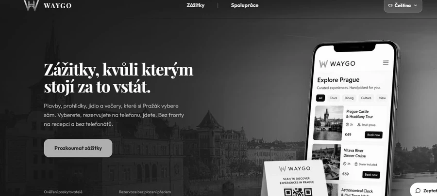
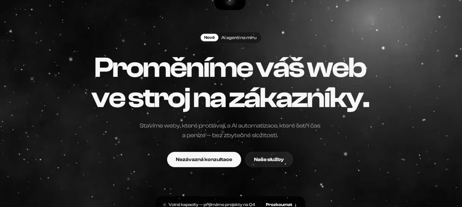

# Oliver Žaigla

I’m a developer in Prague and co-founder of **SiteSpot**. I build what happens after someone clicks, scans a code, or sends a message. At Waygo that means taking a guest from a hotel QR card to a booking request. At SiteSpot it means connecting a website to the tools a team uses to do the work.

[**Selected work**](#selected-work) · [**Try a demo**](#try-a-demo) · [**Portfolio ↗**](https://www.zaigla.com/en) · [**Contact**](#contact)

## Selected work

| [**Waygo ↗**](https://www.waygo.cz/) | [**SiteSpot ↗**](https://sitespot.cz/) |
| :--- | :--- |
|  |  |
| A marketplace for Prague experiences. Hotel guests scan a QR card, pick a local tour or activity, and request it on their phone. | The studio I co-founded. We build websites, AI agents, and automations that connect tools like email, CRM, and invoicing. |

## Try a demo

**Inbox Autopilot** is an interactive SiteSpot demo. Start the sample inbox and open a reply marked as interested to see the follow-up draft. You can also enter your own example and see how it’s classified. **[Try Inbox Autopilot ↗](https://sitespot.cz/demos/inbox-autopilot.html)**

## How I build

- **Follow the handoff.** Start with where an inquiry, booking, or document comes in and follow it to the person who needs the result.
- **Make the result inspectable.** An answer from documents should show its source. A suggested reply should be easy to review before it goes out.
- **Design for retries.** A transient error should leave enough context to resume the job without creating a second record.

Tools I reach for

TypeScript, React and Next.js for interfaces. Python and Node.js for services and integrations. PostgreSQL for data, Docker for packaging, and retrieval-augmented generation for assistants that work with documents.

## Contact

Tell me what comes in, what has to happen next, and where your team still does it by hand.

[**Email ↗**](mailto:oliver@zaigla.com) · [**LinkedIn ↗**](https://www.linkedin.com/in/zaigla/) · [**Portfolio ↗**](https://www.zaigla.com/en)
