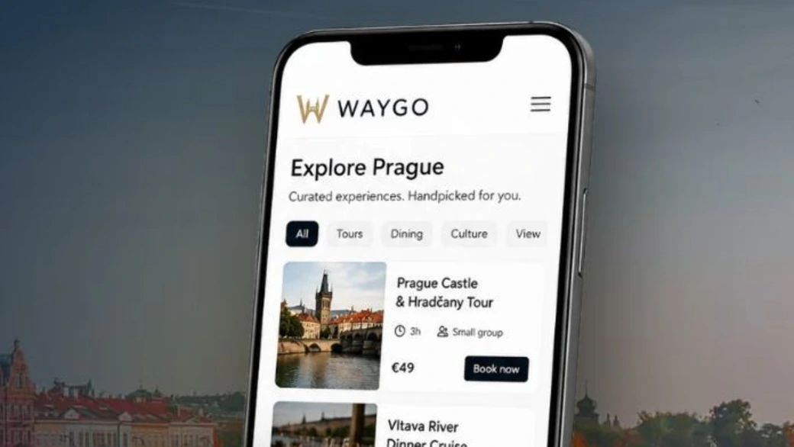

I’m Oliver, a developer in Prague. I build **Waygo** for hotel guests and publish web projects and interactive automation demos on **zaigla.com**.

[Portfolio](https://www.zaigla.com/en)　·　[GitHub projects](#open-source)　·　[Email](mailto:oliver@zaigla.com)

## 

| **Waygo** | **zaigla.com** |
| :--- | :--- |
|  |  |
| A hotel guest scans a card, picks a Prague experience and requests a booking from their phone. | Try an agent that checks sample orders and shows the source behind its answer. |
| [Explore Waygo](https://www.waygo.cz/) · [For the front desk](https://www.waygo.cz/partner/reception) | [Open the demo](https://www.zaigla.com/en#demo) · [Visit zaigla.com](https://www.zaigla.com/en) |

## Behind the screen

**Waygo · One code, two journeys.** Guests want to know what they can do today. The front desk needs a way to help without phoning every operator. [See the catalogue](https://www.waygo.cz/) and [the same flow from reception](https://www.waygo.cz/partner/reception).

**zaigla.com · Where did that answer come from?** Pick the order-approval question in the simulated demo. Four orders pass the CRM check. Two stay in review because their billing addresses don’t match. The answer cites the ERP approval queue so a person can follow up. [Try it](https://www.zaigla.com/en#demo).

## Open source

**[dbt + ClickHouse starter](https://github.com/LiveFuller/ideal-tribble)** uses NYC taxi zones to show how a raw table becomes a tested dbt model. Start with the [staging SQL and schema tests](https://github.com/LiveFuller/ideal-tribble/tree/main/models/staging).

## More web work

**[Lynx Studio](https://lynx-studio-delta.vercel.app/)** is a creative studio website I made as a side project. **[The Meat Boss](https://www.zaigla.com/meat-boss-butchery)** is an independent design concept for ordering from a butcher shop on your phone.

---

[Email](mailto:oliver@zaigla.com)　·　[LinkedIn](https://www.linkedin.com/in/zaigla/)
