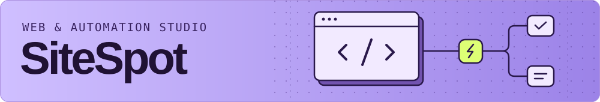
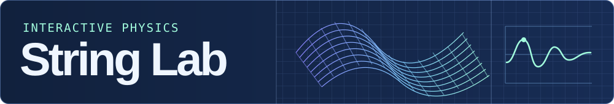

# Oliver Žaigla

I’m a developer in Prague and co-founder of SiteSpot. I build AI agents that can show their sources, automations that connect existing tools, and web apps that take a real task from start to finish.

[**Projects**](#selected-work) · [**How I build**](#how-i-build) · [**Portfolio ↗**](https://www.zaigla.com/en) · [**Get in touch**](#get-in-touch)

## Selected work

### Waygo · Prague in your pocket

A marketplace for Prague hotel guests. Scan a QR card at reception, find a local tour or a boat trip, and request a booking on your phone. **[Explore Waygo ↗](https://www.waygo.cz/en)**

### SiteSpot · Websites, agents & automation

The studio I co-founded. We build websites and connect the tools behind them, from capturing an inquiry to routing it to the right person. **[Visit SiteSpot ↗](https://sitespot.cz)**

### String Lab · Physics you can manipulate

A browser-based lab for string theory and astrophysics. Explore derivations, change parameters in live charts, and see how the models behave in interactive 3D scenes. **[Open String Lab ↗](https://stringlab-black.vercel.app/)**

## How I build

- **Start with a concrete task.** Follow it from the first input to the person who needs the result.
- **Make decisions inspectable.** Show the source behind an AI answer and give uncertain cases a way to reach a human.
- **Build for the second run.** Keep retries from creating duplicate records, and give the next person enough context to maintain the system.

<strong>Open the toolkit</strong>

- **Interfaces and APIs:** TypeScript, React, Next.js, Node.js, Python
- **Data and delivery:** PostgreSQL, Docker, AWS
- **AI and automation:** retrieval-augmented generation (RAG), tool calling, workflow integrations

## Get in touch

If your team keeps copying data between two tools or answering the same question from a pile of documents, tell me what that looks like today.

[**Email me ↗**](mailto:oliver@zaigla.com) · [**LinkedIn ↗**](https://www.linkedin.com/in/zaigla/) · [**Portfolio ↗**](https://www.zaigla.com/en)
