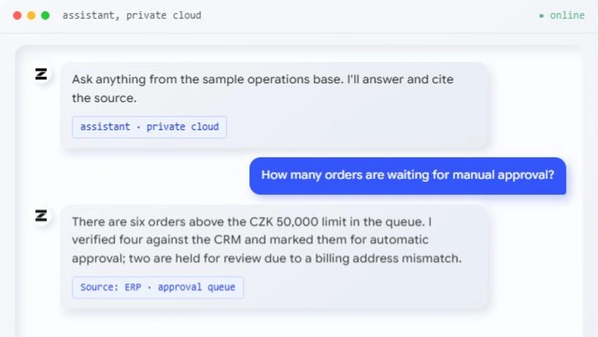
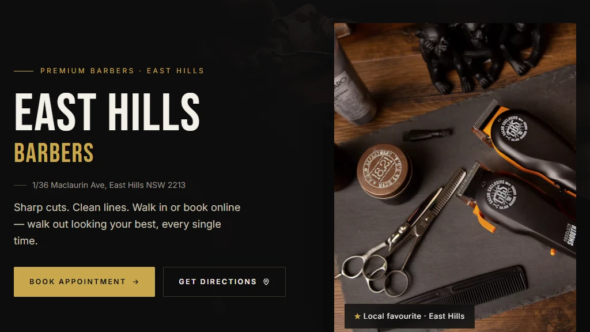
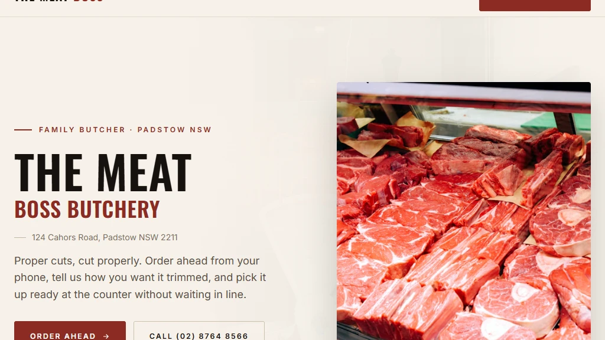

I’m Oliver, a developer based in Prague. I build **Waygo** for hotel guests and publish web projects and interactive automation demos on **zaigla.com**.

[Products](#user-content-selected-work) · [Build notes](#user-content-behind-the-build) · [Web projects](#user-content-web-projects) · [Code & data](#user-content-code-and-data) · [Contact](#user-content-contact)

## 

| **Waygo** | **zaigla.com** |
| :--- | :--- |
|  |  |
| **What can we do in Prague today?** Waygo takes a guest from a hotel QR card to an experience they can book on their phone. | **Which orders still need a decision?** Step through a simulated assistant that explains which orders it flagged and where its answer came from. |
| [Explore Waygo ↗](https://www.waygo.cz/) | [Try the agent demo ↗](https://www.zaigla.com/en#demo) |

## 

### Waygo · From the front desk to a booking

A guest asks for a recommendation at reception. The desk gives them one QR code that opens the catalogue on their phone. The guest picks a Prague experience, requests a booking and gets their voucher after confirmation.

| Start here | What you’ll see |
| :--- | :--- |
| [The front-desk flow ↗](https://www.waygo.cz/partner/reception) | The QR handoff from reception to the guest’s phone. |
| [Browse experiences ↗](https://www.waygo.cz/discover) | The catalogue for walks, boat trips and other things to do in Prague. |

### zaigla.com · Give the exception a reason

In the simulated demo, choose the question about orders waiting for manual approval. Four orders pass the CRM check. Two are held because the billing addresses don’t match. The answer cites the **ERP approval queue** so a reviewer has somewhere to check the decision.

[Run the example ↗](https://www.zaigla.com/en#demo)

## 

| **East Hills Barbers** · Website preview | **The Meat Boss** · Independent concept |
| :--- | :--- |
|  |  |
| A barbershop site with a service menu, directions and a path to online booking. | An order-ahead prototype for a local butcher. Pick a cut, add preparation instructions and enter a pickup time. |
| [See the site ↗](https://www.zaigla.com/east-hills-barbers) | [Explore the order flow ↗](https://www.zaigla.com/meat-boss-butchery#order) |

**[Lynx Studio ↗](https://lynx-studio-delta.vercel.app/)** is a side project that explores motion, typography and a case-study layout for a creative studio.

## 

### dbt + ClickHouse · Build a usable lookup table

This starter takes a raw NYC taxi-zone table and exposes a staging view with consistent column names. It also defines two dbt checks on `location_id`: the ID must be present and unique.

| Read the code | What it does |
| :--- | :--- |
| [Source definitions](https://github.com/LiveFuller/ideal-tribble/blob/main/models/staging/sources.yml) | Declares the raw tables the project can reference. |
| [Staging SQL](https://github.com/LiveFuller/ideal-tribble/blob/main/models/staging/stg_taxi_zones.sql) | Maps fields like `LocationID` and `Zone` to `location_id` and `zone_name`. |
| [Schema checks](https://github.com/LiveFuller/ideal-tribble/blob/main/models/staging/schema.yml) | Defines the tests that catch missing and duplicate IDs. |

[Browse the repository ↗](https://github.com/LiveFuller/ideal-tribble)

## Contact

Working on a booking flow, internal tool or data pipeline? Tell me where it starts and who needs the result.

[Email](mailto:oliver@zaigla.com) · [Portfolio ↗](https://www.zaigla.com/en) · [LinkedIn ↗](https://www.linkedin.com/in/zaigla/)
